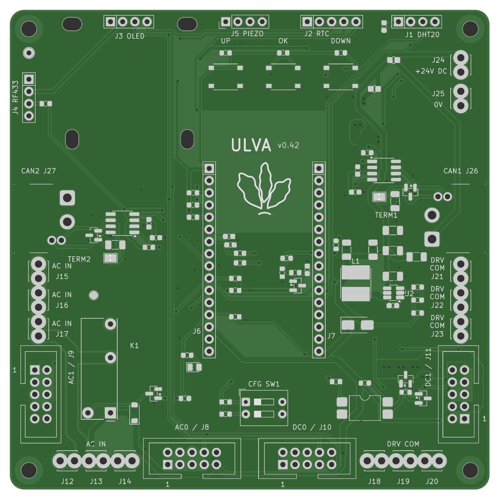
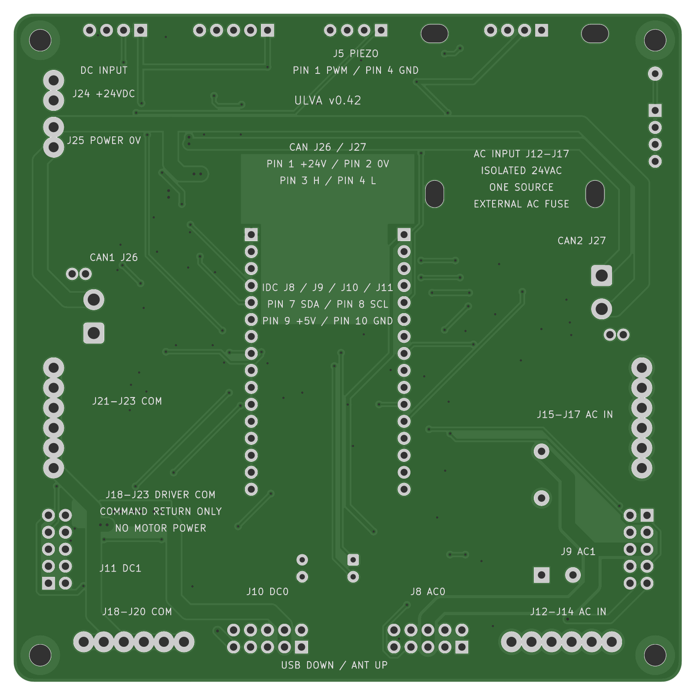
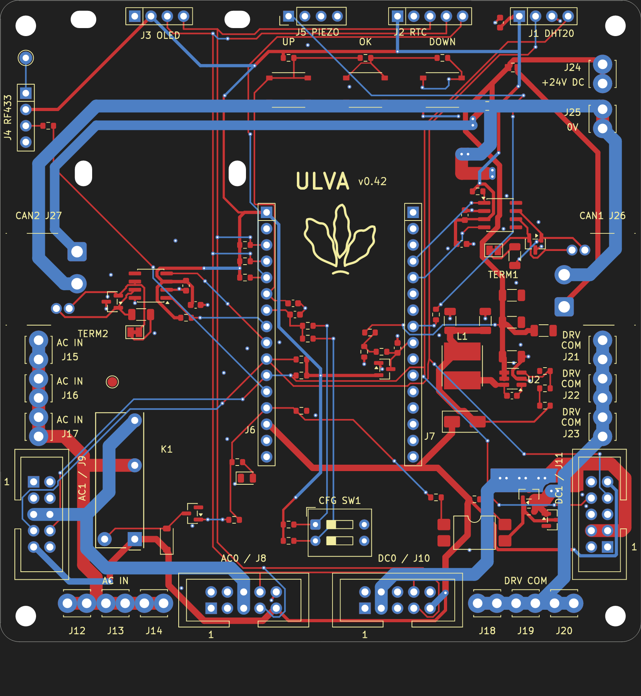
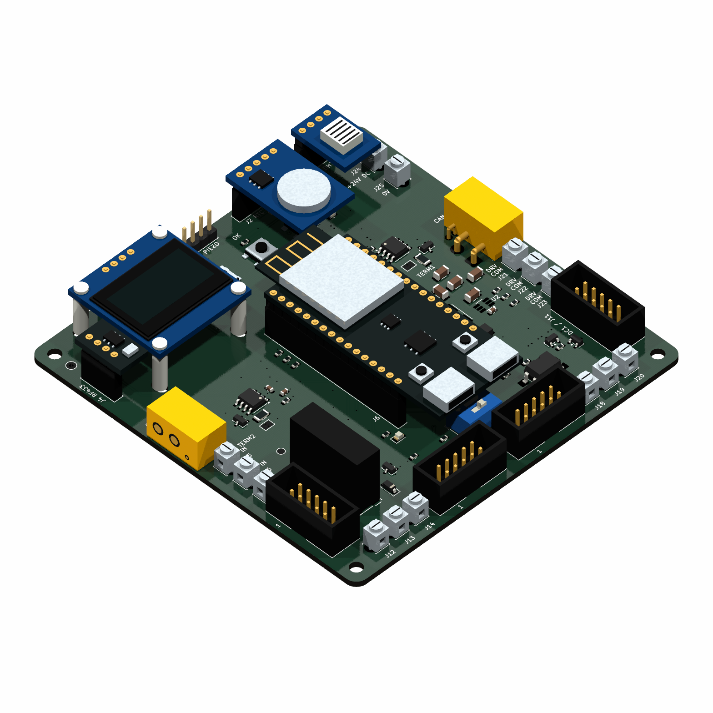

# Ulva

An open-source ESP32-C5 controller board for robotics and controlled-environment agriculture (CEA).

The repository contains a 100 × 100 mm, two-layer carrier PCB, eight KiCad
schematic sheets, project libraries and an ESP-IDF button-input example.
The current board revision is **v0.42**.

- Two CAN FD interfaces with fused 24 V control-power outputs.
- 24 V DC input and an onboard 5 V supply.
- Two I²C buses, peripheral connections and
  [OpenSprinkler-compatible AC/DC expansion](docs/hardware.md#opensprinkler-acdc-expansion).
- OLED, RTC, DHT20, 433 MHz receiver and passive piezo connections.
- Three ADC buttons, a two-switch configuration input and voltage monitoring.

This is a prototype. Full controller firmware and physical validation remain
unfinished. See the [hardware reference](docs/hardware.md) for pin assignments,
power limits and wiring.

## Board views

CAD renders of the current board:

| Front | Back |
| --- | --- |
| [](docs/images/pcb-fabricated-top.png) | [](docs/images/pcb-fabricated-bottom.png) |
| **Routing** | **3D assembly** |
| [](docs/images/pcb-routing.png) | [](docs/images/pcb-assembly.png) |

[Interactive board viewer](https://ivere27.github.io/ulva/)
· [HTML source](docs/index.html)

Switch between the Routing, 3D, Schematic and Orders tabs. Routing lets you select
traces, vias or pads to highlight a net, search components, switch copper layers,
zoom and save a selection image. Ground pours are omitted; both layers use
front-view coordinates. Schematic provides a thumbnail sidebar for all eight
sheets, with zoom, pan and a PDF download. Orders lets you select JLCPCB assembly
or loose LCSC parts and download supplier files; see the
[order workflow](tools/README.md).

For offline use, keep the complete `docs/` directory and open `docs/index.html`
directly in a browser. In Routing, choose `routing/board.svg` when prompted. In
3D, choose `3d/assembly.json` and `3d/board.glb` together. A local server is optional;
the browser needs explicit file selection to read these data files from disk.
Schematic images, the PDF and Orders open directly without a file picker.

**Version details** shows the board revision, an **Export base** commit and
source/export SHA-256 hashes. Export base records Git HEAD when the metadata was
generated. Each view retains its own recorded source hashes, so older exports
can be distinguished from the current sources.

### 3D assembly

[Open the 3D tab](https://ivere27.github.io/ulva/#3d)
· [Export and usage guide](docs/3d.md)

Rotate, zoom and pan the assembly, or show and hide individual components and
modules. Visibility controls affect the view only. Some component shapes and
module mounting heights are illustrative; the KiCad board remains authoritative.

## Open the project

Open [`ulva_controller.kicad_pro`](ulva_controller.kicad_pro) in KiCad 9 with
its standard symbol and footprint libraries installed. The included project
libraries use relative paths.

| Path | Contents |
| --- | --- |
| `ulva_*.kicad_*` | Schematics, PCB, project settings and design rules |
| `Ulva.kicad_sym`, `Ulva.pretty/` | Project symbols and footprints |
| `Ulva.3dshapes/` | Original terminal-block visualization models |
| [docs/hardware.md](docs/hardware.md) | Hardware and pinout reference |
| [docs/bom.md](docs/bom.md) | Parts and assembly ownership |
| [docs/3d.md](docs/3d.md) | 3D viewer, export and model limitations |
| [tools/](tools/README.md) | JLCPCB and LCSC order preparation and unit tests |
| [scripts/](#verification) | KiCad DRC/ERC validation, SPICE simulation and export runner |
| [firmware/buttons_adc/](firmware/buttons_adc/README.md) | Button example, host unit tests, build and integration instructions |
| `artwork/ulva-icon.svg` | Board icon |

## Verification

Use Python 3.10 or later. Button tests need CMake and a C compiler. CAD checks
use KiCad 9's `kicad-cli` and `pcbnew` module in the same Python environment,
plus `ngspice` for analog checks. Without native KiCad, the runner uses Docker
with the pinned `kicad/kicad:9.0.9` image.

From the repository root, install the rendering dependencies needed for PCB,
Gerber and board-documentation checks, then run the relevant checks:

```sh
python3 -m pip install --target build/preview-python \
  gerbonara==1.5.0 resvg-py==0.2.6
python3 -m unittest discover -s tools
python3 scripts/run_checks.py buttons
python3 scripts/run_checks.py schematic
python3 scripts/run_checks.py pcb
```

The runner checks a disposable snapshot and writes logs and receipts under
ignored `build/runs/`. Use the runner rather than invoking its export helpers
directly. Automated checks do not replace physical hardware validation.

When board images or the routing viewer need regeneration:

```sh
python3 scripts/run_checks.py board-docs
# After reviewing the generated assets, update the images and routing viewer:
python3 scripts/run_checks.py board-docs --update-docs
```

To regenerate the schematic pages and PDF, use Python 3.10 or later and KiCad 9's
`kicad-cli`. Review the output in `build/schematic-docs/`, then publish it:

```sh
python3 scripts/export_schematic_docs.py
python3 scripts/export_schematic_docs.py --update-docs
```

After updating public viewer assets, refresh their version metadata. This reads
the existing files; regenerate any affected view first:

```sh
python3 scripts/export_viewer_info.py
```

## License

Original Ulva design files, firmware, documentation and artwork are released
under the [MIT License](LICENSE). Upstream library data and dependencies retain
their own licenses; see [third-party notices](NOTICE.md).
