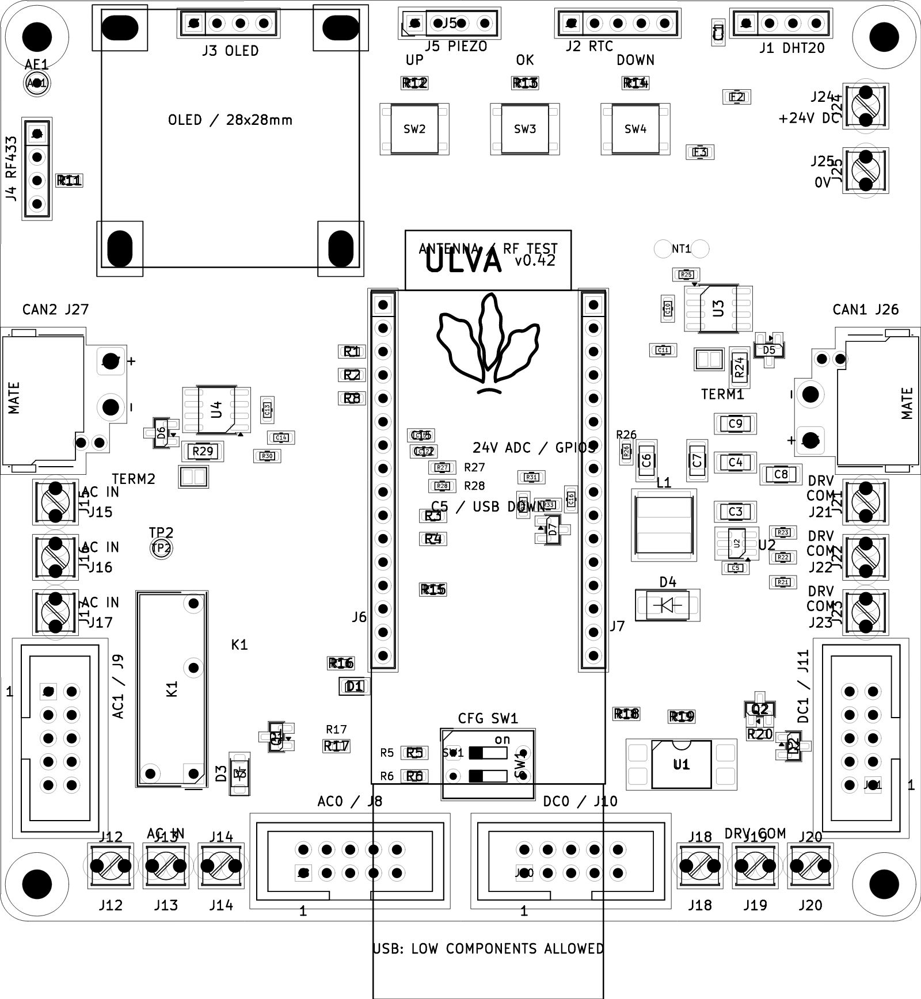

# Ulva

An open-source ESP32-C5 controller board for robotics and controlled-environment agriculture (CEA).

The repository contains a 100 × 100 mm, two-layer carrier PCB, eight KiCad
schematic sheets, project libraries and an ESP-IDF button-input example.
The current board revision is **v0.42**.

- Two CAN FD interfaces with fused 24 V control-power outputs.
- 24 V DC input and an onboard 5 V supply.
- Two I²C buses, peripheral connections and
  [OpenSprinkler-compatible AC/DC expansion](docs/hardware.md#opensprinkler-acdc-expansion).
- OLED, RTC, DHT20, 433 MHz receiver and passive piezo connections.
- Three ADC buttons, a two-switch configuration input and voltage monitoring.

This is a prototype. Full controller firmware and physical validation remain
unfinished. See the [hardware reference](docs/hardware.md) for pin assignments,
power limits and wiring.

## Board views

CAD renders of the current board:

| Front | Back |
| --- | --- |
|  |  |
| **Routing** | **Placement** |
|  |  |

[Interactive routing viewer](https://ivere27.github.io/ulva/routing/)
· [HTML source](docs/routing/index.html)

The viewer loads its board drawing from `docs/routing/board.svg`.
For offline use, download both files, open `index.html` in a browser and choose
`board.svg` when prompted. Select traces, vias or pads to highlight a net,
search nets and components, switch copper layers, zoom and save a selection image.
Ground pours are omitted; both layers use front-view coordinates.

## Open the project

Open [`ulva_controller.kicad_pro`](ulva_controller.kicad_pro) in KiCad 9 with
its standard symbol and footprint libraries installed. The included project
libraries use relative paths.

| Path | Contents |
| --- | --- |
| `ulva_*.kicad_*` | Schematics, PCB, project settings and design rules |
| `Ulva.kicad_sym`, `Ulva.pretty/` | Project symbols and footprints |
| [docs/hardware.md](docs/hardware.md) | Hardware and pinout reference |
| [docs/bom.md](docs/bom.md) | Parts and assembly ownership |
| [tools/](tools/README.md) | JLCPCB and LCSC order preparation |
| [firmware/buttons_adc/](firmware/buttons_adc/README.md) | Button example, build and integration instructions |
| `artwork/ulva-icon.svg` | Board icon |

## License

Original Ulva design files, firmware, documentation and artwork are released
under the [MIT License](LICENSE). Upstream library data and dependencies retain
their own licenses; see [third-party notices](NOTICE.md).
